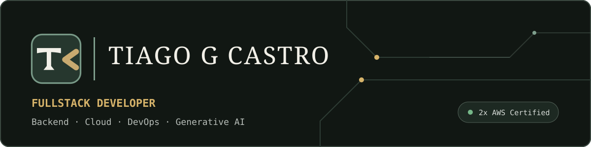
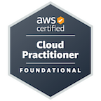
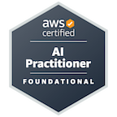
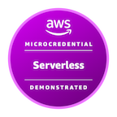

  

  
  
  
  
  

## Core stack

  

  <strong>Backend & APIs</strong> · <strong>Cloud & DevOps</strong> · <strong>Data platforms</strong> · <strong>Generative AI</strong>

## About

I'm a **Fullstack Developer** with 6+ years of experience building and evolving production software with **Node.js, TypeScript, React, Next.js and AWS**.

I work across the full development lifecycle—from APIs and web interfaces to cloud infrastructure, data pipelines, CI/CD and observability. My recent work combines backend engineering, AWS, DevOps, data platforms and Generative AI.

## Selected work

- **LakeIT · Enterprise data platform** — APIs, web applications, ETL and event-driven pipelines, AWS infrastructure with Terraform/Terragrunt, and data exploration with Amazon Bedrock. The infrastructure redesign helped reduce monthly AWS costs from **US$2,300+ to US$800–1,000**.
- **FutBuyNow · International B2C marketplace** — Technical ownership across architecture, payments, automation, real-time operations and SEO. The platform processed **65,000+ orders**, expanded to **16 languages**, and reached **1.5M+ Google impressions** in 12 months.

Explore the engineering context and complete case studies at **[tiagogcastro.com.br](https://tiagogcastro.com.br)**.

## Certifications

  
  &nbsp;&nbsp;
  
  &nbsp;&nbsp;
  

  AWS Certified Cloud Practitioner · AWS Certified AI Practitioner · AWS Serverless Demonstrated 
  <a href="https://www.credly.com/users/tiagogcastro">View all credentials on Credly</a>

## GitHub activity

  
  

  Currently exploring <strong>Go</strong> and going deeper into software architecture, cloud and AI-assisted engineering.

